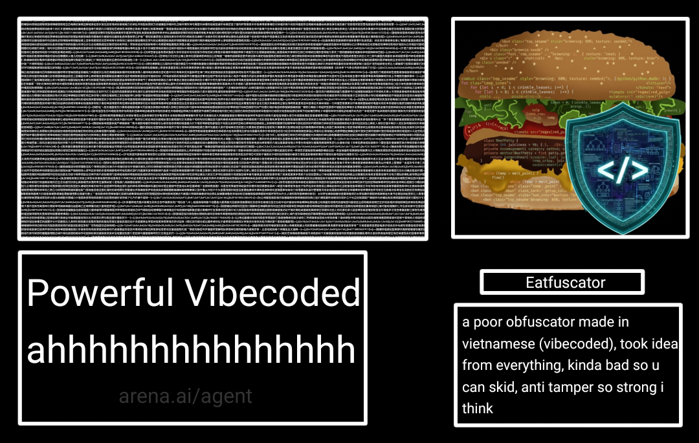

[](https://www.gnu.org/licenses/agpl-3.0.html)
[](https://www.lua.org)
[](https://www.roblox.com)
[](https://luau.org)


# Eatfuscator

https://dsc.gg/Eatfuscator

Lua / Luau source protection.

```lua
-- Protected By Eatfuscator | dsc.gg/eatfuscator
return({function(...)<body>end})({...})
```

## Pipeline

```
source -> macros -> Luau lowering -> constant folding -> minify
       -> keyring (ChaCha12: k0 / k1 / k2)
       -> register-bytecode compile -> per-proto pool shuffle
       -> instruction cipher (k2) -> constant-string cipher (k1, per-proto rounds)
       -> LZSS pack -> layered affine cipher -> 12-bit CJK storage
       -> shuffled payload bank -> decoy banks -> wrap
       -> loader control-flow flattening -> loop shaping -> Luau re-sugaring
```

At run time the loader reverses it:

```
VM dispatch -> chunk unpack -> cipher peel -> LZSS inflate
            -> three-key bank gate -> image decipher (k2) -> constant strings (k1)
            -> integrity gate -> bytecode interpreter -> your program
```

The payload is never Lua text at run time and is never handed to a host
compiler: there is no `loadstring`, no `load` and no `loadfile` anywhere in the
build or in the artifact. What the loader reconstructs is a bytecode image for
the interpreter described below.

| Layer | What it does |
|---|---|
| **Payload** | the compiled image is LZSS-packed (12-bit offset / 4-bit length, lazy matching) before any encoding, so large files usually come out *smaller* than the input |
| **Upvalues** | the loader is a chain of 6 nested closures; bank, order, program, rolling key and the state constants are carried as upvalues, and every VM handler closes over the state table instead of touching globals |
| **Names** | every identifier the loader needs (`string`, `table`, `math`, `type`, `select`, `pcall`, `rawget`, `next`, `getmetatable`, `setmetatable`, `debug`, `getfenv`, `error`, `print`, `warn`, `unpack`, `tonumber`, `gethook`, `info`, `__index`, `__newindex`, `concat`, `floor`) is stored only inside a 25-string encrypted pool that is rebuilt in memory at run time — the artifact never spells a global's name in readable form |
| **Storage** | packed bytes become CJK characters, 2 characters per 3 bytes; no byte-array literals and no XOR anywhere |
| **Cipher** | payload chunks take 1–4 affine layers each, with their own multiplier, addend, step and reversal flag, peeled in reverse order. Inside the image two more ciphers run, both keyed from the ring: every instruction word is one affine map `w' = (w*m + s) mod 2^32` (odd `m`, so it is a bijection) undone while the image is read, and every string constant is offset by a Lehmer keystream whose multiplier is picked per build (16807 / 48271 / 69621 / 40692) and whose pass count is drawn per constant (1–3), so two prototypes holding the same literal do not hold the same bytes, two literals in *one* function do not take the same number of passes, and a dumped function does not reveal its neighbour's cipher |
| **Banks** | payload is split per chunk, stored shuffled, plus 2–4 decoy entries that are never referenced by the order array |
| **Macros** | four call macros — `EAT_STRING`, `EAT_NUMBER`, `EAT_FUNCTION`, `EAT_RAGEBAIT` — are expanded before anything else runs, so the values they carry are never literals in the source the compiler sees. Expansion is a lexer, not a text replace: names in comments, strings, long brackets and backtick strings are untouched, arguments are paren-balanced, and nested calls expand inside-out. Keys are drawn per site from the build seed. See the [Macros](#macros) table |
| **Bytecode** | the source is compiled at build time to a register instruction set of our own (53 opcodes: moves, table/field ops, arithmetic, comparisons, jumps, `CALL`/`TAILCALL`/`RETURN`, boxed locals for upvalues, numeric and generic `for`, and the fused constant forms below). A local a closure can *write* is boxed, so upvalue writes are real and shared, not copies; a local that is bound once and never assigned again is captured **by value** instead, which removes both the cell and the per-read dereference |
| **Fusion** | the compiler never emits `LOADK t k` followed by `ADD d b t`. When an operand is a literal with no side effects it becomes part of the instruction that consumes it (`ADDK d b k` is `d = b + K[k]`, `GETTABLEC d b k` is `d = b[K[k]]`, `SETTABLEC a b k` is `a[K[k]] = b`). On `Test/sha.lua` that removes 202 of 2328 instructions and 30% of the run time of an arithmetic loop; it costs nothing in size because the constant was already in the pool |
| **Pool** | each proto's constant pool is grown in source order by the compiler, which hands an analyst the function's names back in reading order. After the proto is emitted, the pool is permuted with the build seed and every instruction that names a constant is rewritten to the new index (`LOADK`/`GETGLOBAL`/`SETGLOBAL` in `D`, `GETTABLEC`/`SETTABLEC` and the fused `*K` forms in `C`), so the same seed always lays out the same pool and different seeds never share a layout |
| **Constants** | literals stay enciphered past load. Numbers and booleans are deciphered as the image is read; **strings are not** — each one leaves a ciphertext slice behind and the prototype's constant table is read through a `__index` metamethod that decrypts a slot the first time the prototype touches it and writes the plaintext back with a plain assignment (the metatable carries only `__index`, so the write cannot re-enter it — no `rawset` and no extra global). A literal in a branch that never runs is never decrypted, and a memory snapshot of a running build holds only the strings it has actually used |
| **Decoys** | 2–4 dead prototypes ride in the root's child list per build: plausible code words, plausible constants, unreachable through any `CLOSURE`. A dump shows more functions than the source had, and how many is a draw from the build stream |
| **Interpreter** | the runtime carries a complete register machine: constant folding happens at build time, so what runs is a flat instruction stream. Every build permutes the opcode numbers (`remap`), and the compiler emits the permuted numbers directly, so two builds of the same file share no opcode value. Instruction fields are peeled with plain arithmetic (no host call per field), the dispatch chain is ordered by measured opcode frequency (`BOXGET`, `LOADK`, `MOVE`, `BOXSET`, `BOX`, `ADD`, …), arithmetic operands are read straight out of live locals instead of being copied into temporaries, a one-result call with up to three arguments runs without building an argument or result table, a literal that feeds an operator or a field access is folded into the instruction instead of being loaded first (`ADDK`, `SUBK`, `MULK`, `DIVK`, `MODK`, `GETTABLEC`, `SETTABLEC` — the superoperation idea from IronBrew2 and Clyde, done at emit time), and a `for` control variable is only boxed when a closure can see it, a call's result count is taken from `select("#", …)` so trailing `nil`s survive a round trip (`print(f())` where `f` returns `(1, nil)` prints both), and a parenthesised expression collapses to exactly one value as the language requires. Luau semantics are honoured — generalized iteration (`for k, v in t`), `continue`, compound assignment, if-expressions, type annotations |
| **VM** | chunk decoding is driven by an opcode program: `load → unpack → peel → append`, executed by a shuffled handler table keyed `0x<hex>`. Opcodes are enciphered with a rolling key and stored as CJK, never as readable numbers |
| **CFF** | the assembled loader is parsed (`luaparse`) and its body is rewritten into a state machine: statements are cut into blocks, the blocks are *emitted in shuffled order*, and each branch advances the state through a transition table (`{[state]=next}`) while consuming its own edge. Source order therefore says nothing about execution order, and a state that is re-entered or jumped into has no edge left, so it falls through to the trap. Every block also bumps a traversal counter, and the block that carries the loader's tail compares it against the expected block count before the payload runs, so deleting, skipping or duplicating a block reaches the trap instead of the payload. Locals a later block reads are hoisted to the body head (assignment form, same semantics), so no block depends on source order. `--setting flatten:off` keeps the straight-line body; `--setting blocks:<n>` sets how many blocks the machine is cut into |
| **Shape** | the last source-level pass, and the one that decides what the artifact still *looks* like. Every loop is re-spelled: `while true do B end` becomes `repeat B until false`, and `while C do B end` becomes `if C then repeat B until <C inverted> end`, so the emitted text stops announcing loop heads and their tests. Comparisons are inverted operator-by-operator (`<` → `>=`, `==` → `~=`) instead of paying a `not` per pass, and a loop is only touched when the rewrite is provably exact — a body that declares a name the condition mentions keeps its original spelling. After this pass there is no `while` keyword left anywhere in the artifact. The same step audits the name space: every identifier that survives is checked against the build's glyph family, and `tools/audit.js` reports anything readable |
| **Compress** | `Max` / `Both` use larger chunks and more cipher layers to squeeze the artifact further |
| **Anti tamper** | the constants the loader depends on live in their own 38–42-slot encrypted CJK bank: the slot count, source length, both source checksums, the packed-stream length and checksum, `k0`, `k1`, the chunk count, the six state constants and a mixture `sum(c[i]*(i+2)) mod 2^24` over the whole bank (its own slot excluded) are all stored there, so nothing in the artifact spells out a length or a checksum in readable form. The instruction inverse multiplier, `k2` and a mixture of all three keys are bank slots too, so a patched slot has to agree with a value derived from `k0`, `k1` *and* `k2` at once. The bank is also **38–42 slots** (the count is drawn per build and checked against the real length). Two of those slots carry words 1 and 9 of a **512-bit rolling digest over the decoded image** — the loader re-walks every payload byte and any disagreement is a delta like the others — and two more carry the **factoradic permutation codes** that describe the image itself: the order the seven header fields are written in, and how the five constant type tags are numbered. A reader who learns one build's header order learns nothing about the next one, and a tag byte has no fixed meaning at all. Lengths, both checksums, the packed checksum, the bank mixture, the slot count, the pool fingerprint, the chain's state constants and the environment anomaly are each turned into a delta and folded into one numeric key. Nothing returns `false`, nothing compares strings: only key `0x0` reaches the payload runner — every other key lands on the trap |
| **Trap** | no visible trap loop and no trap string: the trip-wire is a *checksum walk* that is never expected to be called — `for i=seed,0x7FFFFFFFFFFF do ... end` with a two-name parameter rotation, so it reads as one more fingerprint loop sitting next to the real ones. Its bound is astronomically large, so a tripped build parks there forever: nothing is printed, nothing is raised, and `pcall` has nothing to catch. Two shapes are generated per build (flat and nested), each with fresh names, modulus, key and seed |
| **Chunk identity** | the loader asks the host who it thinks it is running as: `debug.info` is resolved through the encrypted string pool (so neither `debug` nor `info` is readable in the artifact) and probed as `debug.info(2, "s")` / `debug.info(2, "l")` from inside the loader frame. A host that answers with the wrong types, or that fails the call, is lying about its own stack and gets the trap. Then the returned chunk name goes through a byte census: a name that is a **bare lowercase word** — the `loadstring(src, "=dump")` shape a re-hosted artifact arrives under — is treated as tampering. A file path, a `[string "…"]` chunk and an `=Named.One` chunk all pass. Hosts without `debug.info` (Lua 5.1, sandboxes) skip the probe instead of dying |
| **Anti env** | a runtime fingerprint pass runs before the payload: string/table/math/select/tonumber behaviour, `pcall` shape, `_G` metatable proxying, `rawget` vs indexed global divergence, and installed `debug` hooks. A hooked or proxied environment traps before a single byte of the payload executes |
| **Size** | filler banks pad the artifact past 500 KB by default; they are structurally valid bank entries that the order array never references, so they cost parse time only. `--setting bloat:<size>` controls it (`512k` default, `off` to disable) |

## Three keys

Every build draws its keys from one generator and then spends them on separate
questions, so no single value ever decodes the artifact:

```
seed -> ChaCha12 (12 rounds, 256-bit state)
      -> domain 0xb1  k0  1..251   payload chunking and the payload checksums
      -> domain 0xb2  k1  1..251   constant-string cipher + keystream multiplier
      -> domain 0xb3  k2  <2^24    instruction cipher (multiplier and addend)
      -> domain 0xa0      1..2^32  every structural draw (names, layouts, filler)
```

The generator is ChaCha12, not a `mulberry32` on 32 bits: a 256-bit key, a
64-bit counter and a 64-bit nonce, twelve rounds of add-rotate-xor per 64-byte
block, and each domain is a separate stream — so `k0`, `k1` and `k2` are not
neighbours in one sequence an analyst can walk backwards, and the structure
stream never repeats a draw the key streams made. Output is taken from the top
24 bits of a word, which is the half a shorter generator leaks least.

The three keys are required *together* at run time:

* the payload chunks are peeled with `k0` (and their checksum is taken with it),
* the instruction image is un-mapped with `k2` — the artifact carries `m^-1` and
  `k2`, and the addend is derived in the loader, so neither half alone is enough,
* the constant strings are decrypted with `k1`, which also picks the Lehmer
  multiplier and each constant's pass count,
* and slot `0x1B` of the constant bank holds `(k0*65537 + k1*257 + k2*17) mod 2^24`.
  The bank mixture check reads every slot, so editing that one to match a
  patched key edits the mixture too. Get one of the three keys wrong and the key
  sum is non-zero, and a non-zero key is the trap, not an error.

## What changes between builds

Same source, different seed, and none of the following is the same:

* the three keys, and therefore every cipher above,
* the opcode numbering (a fresh permutation of all 53 opcodes),
* every prototype's constant-pool layout,
* the **image header layout**: the seven header fields are written in an order
  drawn per build and the five type tags are numbered in a second draw, both
  carried as factoradic permutation codes inside the encrypted bank, so a
  reader cannot even find the field order or the meaning of a tag byte from a
  second build of the same file,
* the opcode handler order, the state keys and the block order of the flattened
  loader, the number of filler banks, decoy chunk contents, the pool order,
* the number of affine layers on the constant bank (1–3), the number of cipher
  passes on each string constant (1–3, drawn per constant), the Lehmer
  multiplier (4 choices), the number of bank slots (38–42), the number and
  contents of the dead prototypes (2–4),
* every identifier in the artifact (2–5 glyph names drawn from one confusable
  family), and the long-bracket level of every CJK blob.

The watermark line and the `return({function(...) … end})({...})` wrapper are the
only things held fixed, because they are the contract with the user.

## Layout

One folder per phase; nothing shares a file with another phase.

```
index.js                     public entry (re-exports src/Core/obfuscate.js)
cli.js                       command line
src/Core/obfuscate.js        the pipeline: options -> steps -> envelope
src/Parser/Luau.js           Luau surface syntax -> Lua 5.1 + desugared operators
src/Steps/Minify/            whitespace, identifier and literal densification
src/Steps/Flatten/           loader-array reshaping and control-flow flattening
src/Steps/Luau/sugar.js      portable -> Luau re-sugaring (compound assign, //)
src/Steps/Macro/             the author-facing macro layer (index.js) and constant folding (fold.js)
src/Steps/Shape/             loop spelling (loops.js) and name-space audit (names.js)
src/Vm/backend.js            compileToImage() / vmSource()
src/Vm/Compiler/             the register compiler, split by concern:
    index.js                 compile() and the phase registry
    capture.js               capture + read-only-capture analysis
    emit.js                  instruction emitting, constant pool, jump patching
    scope.js                 scopes, local lookup, upvalue descriptors
    expr.js                  literals, arithmetic, tables, indexing, calls
    closure.js               capture inventory and child protos
    stat.js                  blocks, locals, assignment, branches, loops, returns
src/Vm/Image/                wire format (encoder.js) and the opcode table
src/Vm/Template/vm.lua       the interpreter itself
src/Envelope/wrap.js         the anti-tamper envelope and the watermark
src/Envelope/Template/       the loader template
src/Codec/lzss.js            LZSS packer
src/Toolchain/luaucli.js     Luau CLI discovery and runs
src/Vendor/                  luaparse (vendored, with its licence)
tools/build_samples.js       deterministic Sample/*.lua
src/Toolchain/suite.js       the self-check: every Lua fixture -> obfuscate -> Luau CLI diff
tools/audit.js               what a reader can still see in a build
```

The compiler is one mutually recursive pass (statements emit expressions,
expressions open closures, closures emit statements), so the phase modules
publish their functions through `src/Vm/Compiler/context.js` and call each
other through it instead of requiring in a cycle.

## Auditing a build

```bash
node tools/audit.js Sample/Normal.lua
```

prints the statement shapes, the keyword census, the readable identifiers and
the string literals that survived encoding. A current build reports
`repeat x32`, zero `while`, and no readable token outside the language keywords.

## No false failures

The integrity gate is deliberately strict and deliberately exact:

- all arithmetic stays inside exact range per step (`< 2^24`), and the final key is a sum of absolute deltas instead of squared ones, so Lua 5.1, 5.2+, Luau, float-only builds and even 32-bit-integer interpreters (`fengari` wraps `2^42` to `0`) agree
- checks are computed over the byte-exact decoded source, never over formatting, timings or environment state
- nothing depends on `os`, `debug`, `io` or random values
- the loader resolves through `getfenv` first and `_ENV`/`rawget` second, so it works both where globals live in `_G` (Lua 5.1/5.3) and where they do not (Luau / Roblox)
- tampering is proven caught in three independent regions (encrypted constant bank, VM program, order array), and the constant bank is re-decoded and re-mixed on every build to prove the stored numbers are exact
- environment logging is proven caught: a `_G` `__index` proxy and an installed `debug` hook both trap, while a clean run and a Luau-shaped run pass
- the cipher-layer invariant is re-verified on every entry at run time, so a corrupted parameter is rejected before the loader runs
- global reads and writes go through the host's *writable* environment (`getfenv(0)` when it is the real one), because modern Luau hands out a read-only `_G` and a payload that assigns a global would otherwise die with `attempt to modify a readonly table`; when `getfenv` is absent or returns a stand-in table the loader falls back to `_ENV`/`_G`, so Lua 5.1, 5.3 and Luau all keep working

Loader names resolve through character codes, so the artifact never contains `loadstring` or `load(`.
`obfuscate()` refuses to emit output that does: the validator greps for both.

## Macros

Four call macros, nothing else. Each one is replaced at build time with code
that rebuilds the same value at run time, so the value itself never reaches the
compiler as a literal and never appears in the artifact.

```lua
local name   = EAT_STRING("skid-detector")
local rounds = EAT_NUMBER(64)
local scale  = EAT_NUMBER(2.5)

local mix = EAT_FUNCTION(function(x)
  local h = 0
  for i = 1, rounds do h = (h * 33 + x + i) % 1000003 end
  return h, "mixed:" .. tostring(x)
end)

if never_expected then
  EAT_RAGEBAIT()          -- prints the taunt, then parks for good
end
```

| Macro | Builds to | Notes |
|---|---|---|
| `EAT_STRING("s")` | `string.char(…)…` | every byte is carried as `byte ± key` with a key drawn per chunk (64 bytes at a time), and the sign of the mask alternates per site. The literal is gone from the source, the image and the artifact; escapes, high bytes and long brackets all round-trip |
| `EAT_NUMBER(n)` | `((q*k+r)*sign + frac)` | `n` is split so that the arithmetic rebuilds it bit-exactly: integers as `q*k+r`, fractions as that plus the fractional literal. Works for negatives, hex, `0.1`, `1e15` |
| `EAT_FUNCTION(fn)` | `({[key]=fn})[key]` | every string and number inside the body gets the two treatments above, recursively through nested functions, then the closure is handed out of a table keyed per build |
| `EAT_RAGEBAIT([msg])` | print + park | prints `eatfuscator said no skid` (or your message), then enters a loop that never ends: nothing raised, nothing returned, `pcall` has nothing to catch. The taunt itself is byte-masked too |

The scan is a lexer, not a text replace. A macro name inside a comment, a
string, a long bracket or a Luau backtick string is left alone, a field called
`t.EAT_STRING` is not a call, arguments are matched by paren balance so a call
spread over several lines still expands, and a macro nested inside another one
is expanded first.

Keys come from the build seed: two builds of the same file share no constants,
and two `EAT_STRING` sites in one build share none either. `--setting seed:42`
pins them.

Invalid arguments are build errors with a line number
(`EAT_NUMBER on line 7 expects a number literal`), never silent passes.

## Borrowed from the field

The macro layer and the superoperation idea (`ADDK`, `GETTABLEC`,
`SETTABLEC`, …) come from the obfuscators this one is measured against —
IronBrew's Lightcore macro pass, IronBrew2's `OpSuperOperator`, Clyde's
`fuseOpcodes`, Prometheus and Catph. The call shape is shared; the *content* is
not: their macros were mostly pass-throughs or toggles, these rebuild the value
at run time. What was **not** taken, and why:

- `while true do end` trip-wires (Prometheus `AntiTamper`) — visible, burns a
  thread; ours parks in a checksum walk that never runs
- sanity-check chains — detect constant patching only; the bank mixture
  already catches that in one sum
- `ConstantArray`, `NumbersToExpressions`, `SplitStrings` — moot, no literal
  survives into the artifact
- `ProxifyLocals` — pointless in a register VM, costs a read per access
- several VMs per build, or a nested helper VM (Catph) — size for no gain over
  the per-build opcode permutation
- camouflage / dead code in the image (Clyde, ironveil) — CFF already shuffles
  the blocks that execute

The AZT source was published on 2026-11-01, so it is the newest reference in
this pile. What was studied and what changed here as a result:

- **lazy constant decoding** (AZT `b[idx]` + `rawset` cache) — taken, and it is
  the biggest change of the round: the constant table is now read through a
  `__index` metamethod, so a string literal the program never reaches is never
  decrypted at all. Their cache key is derived with `bit32` rotates, which is
  Luau-only; ours recomputes a Lehmer stream instead, so the same feature keeps
  working on 5.1 hosts
- **a wide (>256 bit) digest of the payload** (AZT `k.t`, 16 words) — taken as a
  shape, not as an algorithm: theirs leans on SHA-256/512 and `bit32`, ours is a
  16-word rolling mix of plain integer arithmetic under 2^53, so the Lua side
  reproduces it digit for digit on any host. Two of its words travel in the bank
- **dead prototypes** (AZT ships a whole template beyond what the source needs) —
  taken in a smaller form: 2–4 decoy prototypes per build, reachable through the
  root's child array, never closed over, drawn from the build stream
- **`LPH&` base85 storage** — not taken. Their payload is printable ASCII, ours
  is CJK; base85 is denser per character but reads as text in an editor, and a
  readable blob is exactly what this artifact is not supposed to have
- **binary-search dispatch** (`if J<=86 then if J<=42 …`, AZT) — not taken. Our
  chain is ordered by measured frequency, so the hot opcodes answer on the first
  compare; a balanced tree would add compares to them for a win only on cold
  ones
- **one VM per build versus none** — their template is shipped whole and only
  its dispatch table is shuffled; ours is generated, permuted and enciphered per
  build, so there is nothing to diff between two artifacts

## Working on the tool

```bash
npm install          # dev-only: fengari + fengari-node-cli (Lua 5.3 reference) and luaparse (Lua 5.1 parser)
npm test             # the full suite: 734 checks, all green on the official Luau CLI
npm run samples      # rebuild Sample/*.lua deterministically (seed pinned)
npm run check        # the same suite, one seed and one mode (9 s instead of 80 s)
npm run audit        # what a reader can still see in Sample/Normal.lua
```

Every runtime check runs the artifact twice — once through `fengari` (Lua 5.3
with float integers, the strictest host) and once through the official Luau
CLI — and compares stdout with the un-obfuscated source. `npm test` skips the
fengari half with a warning if those dev dependencies are absent; it never
fails a check for a missing optional host.

## Testing your own output

Two entry points, nothing else to keep around:

```bash
node cli.js check out.lua                  # parse the artifact (Lua 5.1 grammar, line:col on failure)
lua out.lua                                # plain run

# env logger — installs a logger, then reports whether the artifact ran or refused
lua env_logger.lua out.lua clean           # -> ran normally
lua env_logger.lua out.lua hook            # debug.sethook installed  -> parks, no output
lua env_logger.lua out.lua proxy           # _G __index installed     -> parks, no output
lua env_logger.lua out.lua luau            # globals off _G           -> ran normally
lua env_logger.lua out.lua                 # all four in sequence
```

`env_logger.lua` reports the two outcomes it can see itself — `ran normally`
(exit 0) and `refused` (exit 3, the chunk raised) — and stays silent for a
build that parks in its trip-wire, because that build never returns at all.
Treat silence past your own deadline as a refusal: a tripped artifact produces
no output, no error and no exit.
Every global (`string`, `table`, `math`, `type`, `select`, `pcall`, `rawget`, `next`, `getmetatable`,
`setmetatable`, `debug`, `getfenv`, `error`, `print`, `warn`, `table.unpack`, `tonumber`, `table.concat`,
`math.floor`) is captured once into an aliased local at the top — through the encrypted pool — and
only ever reached through that alias afterwards. No bare `type(x)` or `pcall(f)` call survives
anywhere in the body, and the artifact contains neither `loadstring` nor `load(`.

## Performance

The interpreter is pure Lua on top of the host VM, so a build costs more than
the source it replaces. Measured with the official Luau CLI on this machine,
`minify: Normal`, `bloat: off`, seed fixed:

| Workload | source | artifact | factor |
|---|---|---|---|
| 3M-iteration integer loop | 48 ms | 2.05 s | ~43x |
| 500k small function calls | 13 ms | 0.75 s | ~58x |
| 200k-element table build + walk | 15 ms | 0.29 s | ~19x |
| 800k calls, 0-2 results | 20 ms | 1.21 s | ~60x |
| `Test/fft.lua` | 46 ms | 3.74 s | ~81x |
| `Test/sha.lua` (SHA-256 bench) | 119 ms | 10.4 s | ~87x |
| `Test/life.lua` (cellular automaton) | 51 ms | 3.94 s | ~77x |

These are ~1.6-2.4x faster than the first build of this interpreter
(field peeling, dispatch order, register-direct operands, the call fast path,
unboxed loop variables, by-value captures). Loop shaping costs nothing: the
`repeat` spelling compiles to the same work the `while` spelling did, and the
operator inversion means no loop pays for a `not` it did not have before. The
remaining cost is the interpreter loop itself: every source instruction becomes
one dispatch.

## Naming rules (enforced at build time)

- the build refuses to emit an artifact with fewer than 4 nested closures or fewer than 4 VM handlers
- every declared identifier is 2–5 glyphs from one confusable alphabet (`l I O 0 o i 1 _`), drawn per build and unique across it — `Il0`, `o1_`, `lI0i`. The set can spell no keyword and no English word (the only letters are l, i and o), it is plain ASCII so every 5.1/Luau host lexes it the same way, and it makes the artifact *smaller*: `Test/sha.lua` dropped from 77,667 to 27,676 bytes when the `_0x` + 16-hex family was replaced
- table keys are `0x<hex>` numerals — no string keys
- every numeral in the artifact is hex: a final pass rewrites decimal literals to `0x…`, so
  the only plain text left is the brand watermark. Real constants (lengths,
  checksums, chunk counts, state values) never appear as numerals at all — they live in the
  encrypted bank
- declarations are batched 6–7 variables per `local`
- watermark comment on line 1, the whole program on line 2, no other comments, no version strings

`obfuscate()` validates its own output before returning: wrapper shape, single line,
identifier rules, key format, absence of XOR / `loadstring`, and **Luau syntax** —
checked by `luau-compile --null --only-parse` when the official toolchain is on
`PATH` (or in `~/.eatfuscator/luau/bin`, see `tools/get-luau.sh`), and by the bundled
Luau→Lua 5.1 lowering shim otherwise. A build that fails validation throws instead
of shipping.

## CLI

```bash
node cli.js in.lua out.lua --setting minify:Normal --setting seed:42
node cli.js -c "print(1)" out.lua
node cli.js minify in.lua out.min.lua        # densify only, no wrapping
```

`minify`: `false` | `Normal` | `Max` | `Both`
`target`: `luau` (default) | `portable`

Anything else is rejected — the CLI exits with
`invalid minify setting: "<value>" — expected one of false | Normal | Max | Both`
instead of falling back to a default. `Normal` is a real transform: a Luau-aware tokenizer
re-emits the source with minimum separators (comment/`--!strict` aware, backtick strings,
`+=`, `continue`), and the result is verified token-for-token against the input before it is
accepted. If the token streams differ, or Lua 5.1 parsing breaks, the build falls back to the
original text rather than shipping a corrupted source.

```bash
$ node cli.js Test/exec/arith.lua out.lua --setting minify:false --setting bloat:off
  Payload: 450 source bytes -> 450 minified
$ node cli.js Test/exec/arith.lua out.lua --setting minify:Normal --setting bloat:off
  Payload: 450 source bytes -> 339 minified
```

```bash
node cli.js in.lua out.lua --setting bloat:off     # compact artifact
node cli.js in.lua out.lua --setting bloat:1m      # 1 MB target
node cli.js in.lua out.lua --setting flatten:off   # straight-line loader body
node cli.js in.lua out.lua --setting blocks:40     # wider state machine
node cli.js in.lua out.lua --setting target:portable   # plain Lua 5.1 spelling
```

### Output dialect

The artifact is **Luau** by default. After the loader is assembled, the emitted
text is rewritten into the densest Luau spelling of the same program:

```
lI0_i=lI0_i+0x1          ->  lI0_i+=0x1
math.floor(a/b)            ->  a//b        (only where both sides are proven numeric)
```

Both rewrites are conservative: a compound target is only rewritten when the
lvalue is a bare name or a pure chain (`t.k` / `t[k]` are skipped, because
Luau evaluates the receiver once and Lua 5.1 semantics would change if the
expression had side effects), and `x = x - -1` is left alone. The result is
re-checked with the syntax gate before it is returned.

`--setting target:portable` emits the same program in plain Lua 5.1/5.3
spelling instead — no `+=`, no `//` — for hosts that are not Luau (LuaJIT,
stock `lua`, a Roblox-free pipeline). Floor division is lowered to
`math.floor(a/b)`, which reproduces Luau's `//` value for every numeric input
(including negatives) while printing like an integer in 5.1.

The build reports the loader shape next to the other counters:

```
Upval : 11 nested closures, 12 VM handlers
Flow  : 33 dispatch blocks
Banks : 5 entries, 7 cipher layers
```

## Module

```js
const { obfuscate, minify, parseMinify } = require("./index");

const out = obfuscate(source, { minify: "Normal", seed: 42 });
// flatten: false            -> keep the loader body straight-line
// blocks: 40                -> cut the flattened loader into 40 blocks
// bloat: 0                  -> no filler banks (default pads past 500 KB)
// target: "luau"            -> the only reference target: the official CLI
```

## Tests

The test corpus is Lua. There is no test JavaScript file anywhere in the
package: `Test/**/*.lua` are ordinary programs, each one runnable on its own
with the official CLI, and `node cli.js suite` is the product command that
drives them.

```bash
npm test                       # full run: 734 checks, ~80 s
node cli.js suite --quick      # one seed, one mode: 411 checks, ~9 s
node cli.js suite --filter=json
node cli.js suite --seeds=5,99
luau Test/cases/json.lua       # a single fixture on its own
```

Each fixture is handled the same way: run the source with the Luau CLI, record
stdout and exit status, obfuscate, run the artifact, diff. On top of the diff
the suite adds the checks a Lua chunk cannot make about its own build —
watermark, exactly two lines, `return({function(...)` wrapper, no
`loadstring`, no surviving `EAT_*` name, zero `while` in the audit, Luau parse
gate, same seed gives identical bytes, two seeds never give identical bytes.
Benchmark fixtures print their own timings; those lines are the only ones
stripped before comparing.

```
Test/cases/     32 language fixtures: strings, patterns, tables, iteration,
                metatables, closures, coroutines, errors, varargs, operators,
                scoping, aliasing, numerics, matrix math, primes, JSON,
                base64/hex, LRU, trampoline, memoisation, control flow, words,
                sets, arithmetic bit ops, DFS/BFS, a tokeniser, big integers,
                coroutine generators
Test/exec/      small programs, including luau_syntax.lua (Luau-only surface)
Test/*.lua      whole-program benchmarks: sha, sha_inlined, aes128, fft, life,
                bignum, bytecode_vm, graphs
```

Behaviour is verified against the **Luau CLI**, not against Lua 5.1: the same
source and every artifact are run side by side and their output diffed.

```bash
sh tools/get-luau.sh          # fetch the official CLI into ~/.eatfuscator/luau
node cli.js suite             # uses it as the gate and the reference runtime
```

When the CLI is missing the Luau section reports `SKIP` and the build falls back
to the internal lowering shim for the syntax gate — never silently to "passed".

The suite covers every fixture in `Test/`, `Test/exec/` and `Test/cases/`: the
language cases are built twice per seed (minified and dense-only) in the
portable dialect, the program and benchmark fixtures in the Luau dialect, and
each build is then run on the Luau CLI and diffed against its source. `Test/exec/luau_syntax.lua` is
written in Luau-only syntax on purpose (`type` aliases, `--!strict`, compound
assignment, `//`, `continue`, if-expressions); it is the regression fixture for
the lowering shim. Lua 5.1 (`fengari`) is still used for the portable builds,
where it proves the `target:portable` spelling really is 5.1-clean.

## Limits

- **One payload function cannot exceed ~32k instructions.** Branches are encoded in a
  24-bit field with a signed 15-bit displacement, so a Lua function that compiles past
  that limit is rejected with `jump out of range (N, limit +/-32767)` instead of
  producing a quietly broken artifact. Split the function; this is the same ceiling a
  real Lua 5.1 `luac` hits with `goto`.
- `target: "luau"` output is not plain Lua 5.1: feeding it to stock `lua` is a syntax
  error by design. Use `target: "portable"` for non-Luau hosts.
- Under `target: "portable"` on Lua 5.1, `1/0` prints `Infinity` where Luau prints
  `inf`; the numeric values agree everywhere else.

## Bot

```bash
npm install -g discord.js      # once, for the whole Node installation
export DISCORD_TOKEN="..."
node bot.js
```

The bot resolves `discord.js` from the Node runtime's own global module roots
first (`npm root -g`, `%APPDATA%\npm`, `NODE_PATH`) and only falls back to a
project `require`. Nothing is unpacked next to `bot.js`, and no `node_modules`
folder travels with the source: install the library once and every copy of the
bot uses that one.

# Credits
### https://arena.ai/agent goatttttt
