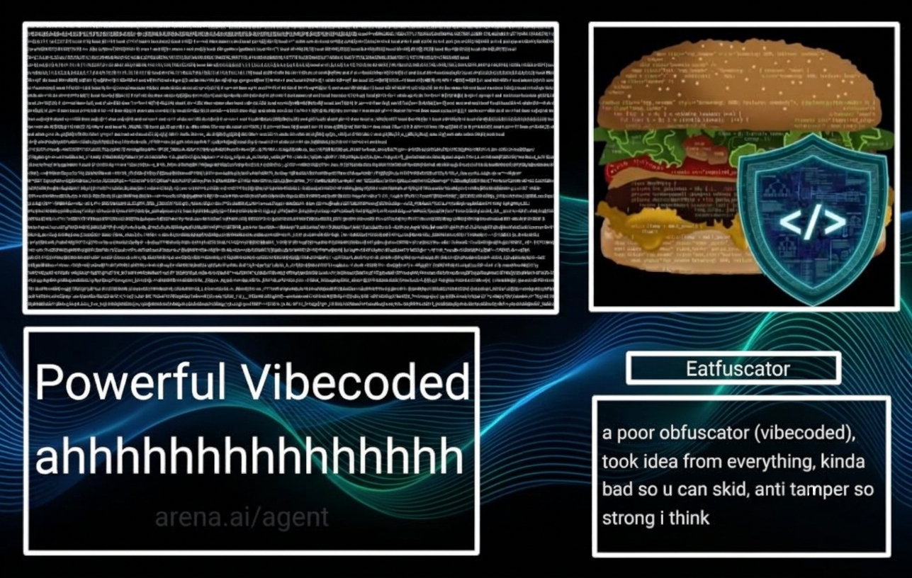

<div align="center">



<br>

[](https://github.com/tienxida112-blip/Eatfuscator/stargazers)
[](https://github.com/tienxida112-blip/Eatfuscator/network/members)
[](https://github.com/tienxida112-blip/Eatfuscator/releases)

[](https://github.com/tienxida112-blip/Eatfuscator/blob/main/LICENSE.txt)
[](https://github.com/tienxida112-blip/Eatfuscator)
[](https://www.roblox.com)

# Eatfuscator

**Lua / Luau source protection.**

Eatfuscator turns source into a custom bytecode VM, then wraps and compresses the loader.  
It has host checks and anti-tamper checks, but it's still obfuscation, not a lock.  
Don't put secrets in code you ship.

</div>

## Pipeline

```text
  Lua / Luau source
          |
          v
  +-------------------------+
  | Macros, Luau lowering   |
  +------------+------------+
               |
               v
  +-------------------------+
  | Compile to VM words     |
  | Relocate + seal image   |
  +------------+------------+
               |
               v
  +-------------------------+
  | VM + host checks        |
  | Flatten loader flow     |
  +------------+------------+
               |
               v
  +-------------------------+
  | Pad, compress, wrap     |
  +------------+------------+
               |
               v
         Output script
```

VM instructions are split into shuffled variable-length blocks connected by jumps. The image forge uses per-build opcodes and varied reversible recipes for each word. Cached words are split across four keyed shards, checked before dispatch, and stay sealed until they run, and opcode masks depend on the prototype and instruction position. Large prototypes that cannot fit signed jump offsets keep their original layout. That makes a straight table dump less useful; a determined runtime observer can still capture the decoder or the instructions as they're used. This costs runtime too, not just build time; CPU-heavy scripts can slow down a lot.

## Usage

Requires Node.js. From the project directory:

```sh
npm install
node cli.js script.lua out.lua --setting seed:42
```

The output path is optional. Seed is the only build setting; the same input and seed give the same output with the same compiler and environment. Omit the seed for a random one; the CLI prints the chosen number. Run `node cli.js --help` for the other input forms.

On Termux, use a `luau-compile` binary built for your device and make sure it is on `PATH`. The bundled binary may not run on Android. If no compiler is found, the CLI warns that the loader was not compile-checked.

The default output targets a Roblox-shaped Luau environment. The compressed loader needs runtime compilation support, so check your host before using it; don't assume it works on every Roblox client. A fake host can be rejected, though rejection isn't guaranteed to be silent. The host checks deliberately catch some errors; an environment logger can show them even when execution succeeds. The host verdict also feeds the VM decoding key, so disabling the error handler alone is not enough in the tested bypass. A patched runtime can still trace output.

`EAT_NO_VIRTUALIZE=1` skips the VM. Btw, that means less protection, not a faster version of the same protection.

## Extract the loader

The outer compression is just packaging. To inspect the generated loader without running it:

```sh
node tools/extract_stage.js out.lua loader.lua
```

This extracts the current bootstrap format, not your original source or the VM bytecode. The tool limits the expanded loader to 64 MiB.

## Macros

Macros use the reserved `EAT_` prefix. Add shims in an `if not EAT_OBFUSCATED then ... end` block to run the source without obfuscating it; the build removes that block. Unknown macro names are errors.

Full example (also in [Test/macros.lua](Test/macros.lua)):

```lua
if not EAT_OBFUSCATED then
  function EAT_STRING(s) return s end
  function EAT_NUMBER(n) return n end
  function EAT_FUNCTION(f) return f end
  function EAT_ASSUME(value, expected) return expected end
  function EAT_OPAQUE(cond) return cond end
  function EAT_SECRET(s, expression, expected) return s end
  function EAT_RAGEBAIT() print("nope") while true do end end
end

local banner = EAT_STRING("hello from macros")
local rounds = EAT_NUMBER(1200)
local add = EAT_FUNCTION(function(a, b) return a + b end)
local slot = 7
local width = EAT_ASSUME(slot, 7)
local secret = EAT_SECRET("bound to slot", slot, 7)
if EAT_OPAQUE(true) then
  print(banner, rounds, add(2, width), secret)
end
if EAT_OPAQUE(false) then EAT_RAGEBAIT() end
```

See [macro.md](macro.md) for all macros. `EAT_SECRET` isn't a safe place for passwords or keys.

## Samples

`Samples/` has ten builds from different randomly selected test files. Their inputs and seeds are in `Samples/manifest.json`. Run `npm run samples` to pick and verify a new set.

## Tests

```sh
npm test
npm run test:flow
npm run test:forge
npm run test:forge-guard
npm run test:resident-guard
npm run test:instruction-digest
npm run test:probes
npm run test:num
npm run test:shard
npm run test:compileguard
npm run test:trap-bypass
npm run test:opcode-mask
npm run test:extract-stage
npm run verify
npm run hosts
npm run tamper -- --runs 40
```

The suite checks the loader without padding; verification exercises padded builds. The included Luau binaries are used by the test tools. Results on a simulated host don't prove compatibility with every Roblox environment.

## License

[GNU AGPL v3](LICENSE.txt).
